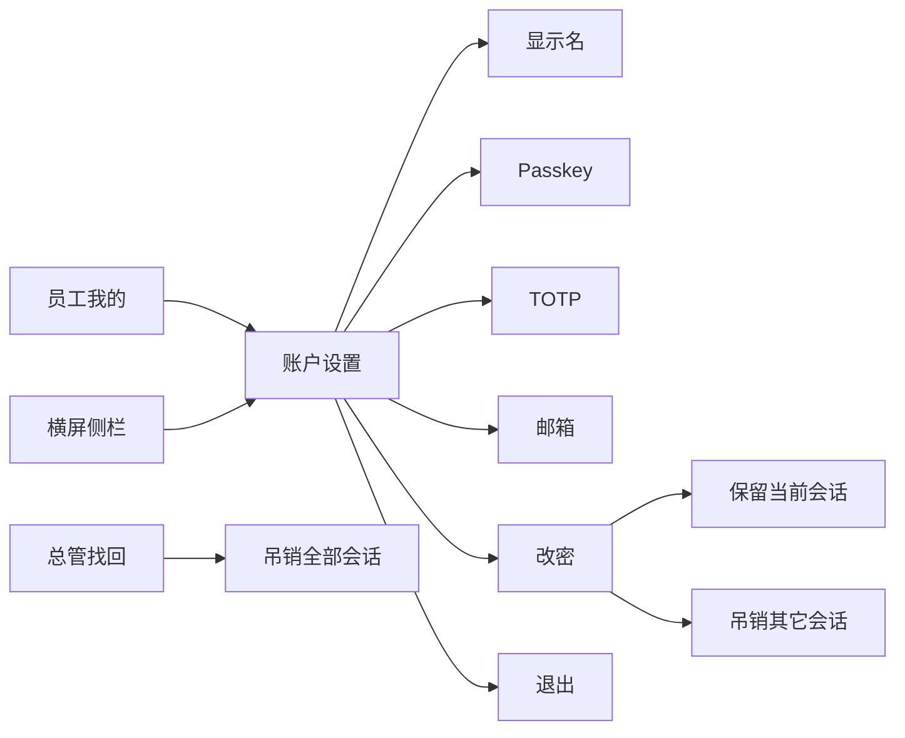

# 技术方案

## 架构

账户设置是已有会话上的本人操作，不新增角色或权限码。鉴权仍是 `CurrentUser`。写接口继续要求 `X-DLZ-Requested: 1`。

## 数据

`migrations/0003_display_name.sql` 给 `account` 增加可空 `display_name`，长度 1–64。空值表示界面回退到 `username`。

`GET /api/me` 增加 `display_name`、`email_verified`、`totp`。评语、改单、账号列表和邀请码末次使用人也带上显示名。匿名评语的显示名与账号同为空。

## 接口

| 方法 | 路径 | 行为 |
|------|------|------|
| PUT | `/api/me/display-name` | `{ display_name }`，可空字符串表示清空 |
| POST | `/api/me/password` | `{ current_password, new_password }`；成功返回吊销的其它会话数，不换当前 cookie |
| POST | `/api/passkeys/register/start\|finish` | 已有接口。展示名用显示名，登录名仍是账号 |
| POST | `/api/me/totp/setup\|confirm` | 已有接口 |
| PUT | `/api/me/email` | 已有接口。邮箱能力关闭时拒绝 |
| POST | `/api/session/logout` | 已有接口。只吊销当前会话 |
| POST | `/api/admin/recovery` | 保持原行为。`reset_password` 吊销全部会话 |

自助改密在事务里锁定账号行、校验当前密码、更新 Argon2id 哈希、吊销 `id <> 当前会话` 的未撤销会话，并作废未消费 magic link。审计动作是 `display_name_update` 与 `password_change`，不记密码。

当前密码错误写入与登录相同的用户键和 IP 键失败窗。

## 前端

`AccountPage.vue` 同时给员工竖屏和横屏侧栏使用。员工从「我的」进入，设备页入口保留。横屏侧栏项为「账户」，不参与登录后的默认落地页。工具栏、问候、评语、改单和找回列表优先显示名；改单在显示名与账号不同时仍保留账号，避免按账号定位失效。

交互按分组列表：先看身份和状态，点一行再编辑。竖屏是整页分组（个人信息、登录与安全、设备、退出），点行进入二级编辑，返回回到列表。横屏左侧是身份和分组导航，右侧是对应内容或编辑。一页一个主按钮；解绑和退出用红色并二次确认。Passkey 先点「添加 Passkey」，名称默认按浏览器和系统生成，绑定后列表显示名称和添加时间。改密在表单旁提示规则，并说明其它设备会退出、本机保持登录。

## 测试

- `normalize_display_name` 单测。
- `tests/phase1_api.rs` 的 `account_settings`：显示名、改密保留当前会话并吊销其它会话、设备记录仍在、magic link 作废、TOTP 标记、退出、总管找回仍吊销当前会话、审计不含密码。
- Playwright：员工走完显示名、Passkey、改密和退出；食堂横屏从侧栏进入并链到设备页。

## 安全

密码仍只用 Argon2id。响应和审计不回显密码哈希、TOTP 密钥（设置当次除外）和会话令牌。不能通过这些接口修改 `username` 或他人账户。
