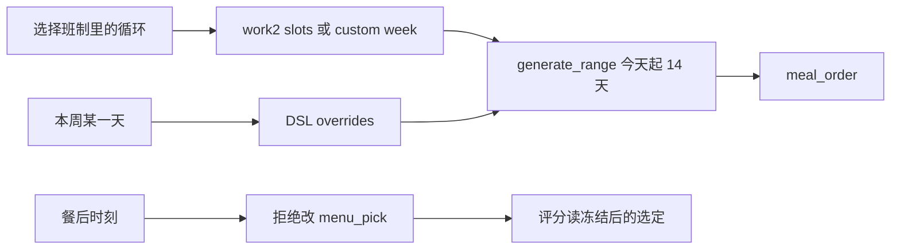

# 技术方案

## 架构

沿用现有 Vue 3 前端和 Rust / Axum / SQLx 后端。不新增权限码，不新增表。

## 报餐

- `PUT /api/me/meal-cycle`：`{ slot, ordering, weekday? }`。上二休四写 `slots`，忽略 weekday。自定义要求 weekday 为 1 到 7，写 `week` 里对应天。然后丢掉该餐尚未锁定的例外；自定义只丢掉同一星期的例外。再按现有窗口生成。
- `PUT /api/me/shift` 仍整份替换 DSL。这样再次保存班制会回到默认循环。
- `write_resolved` 在循环明确不报时写入 `ordering = false`。上二休四只在工作日写入；休息日仍不写行。没有 `shift_plan` 时不把其它天写成不报。
- 维护任务仍是每 30 秒、窗口 `今天..=今天+14`。没有班制也没有报餐记录的账号不生成。
- 首页每个餐次返回 `{ state: ordering | skip | unset, locked }`。锁定不再覆盖成单独的 locked 状态。

## 供应

- `service_started` 为北京时间 `now >= 餐日 + 餐后时刻`。
- `PUT` 选定在开饭后返回 `menu_frozen`。周视图和当餐选定带 `frozen`。
- 评分目标仍只含 `menu_pick` 里的餐品。没排菜就没有可评项。

## 界面

- 员工选择班制页增加循环按钮。保存班制后留在该页。本周未锁定按钮的可访问名称仍是早 / 中 / 晚；锁定后为「早 报 已锁定」这类文案，颜色保持绿 / 橙 / 灰。
- 选菜页开饭后禁用勾选，周格标注已开饭。
- 员工描述生成、预览，以及横屏 / 窄屏 LLM 导航隐藏。页面文件和接口保留。
- 窄屏在零食堂或「更多」里，`system.super` 可 `POST /api/admin/canteens`。

## 测试

- `tests/phase1_api.rs`：早餐开饭前可写、开饭后 `menu_frozen`；首页锁定餐同时带 state 和 locked；循环关掉工作日早餐后，未锁定工作日为不报，休息日无行，已锁定早餐不变。
- 领域单测覆盖 `service_started`。
- e2e：班制页无描述生成；循环场景断言 DSL 和未锁定工作日；选菜点击未开饭的格子；锁定按钮名称改为同时包含状态和已锁定。补写已开饭日期的选定时，测试助手把钟拨到该日零点再拨回。

## 安全

改循环仍要 `shift.self_write`。冻结选定仍要 `optimizer.read` 且食堂范围匹配。拨钟只在 `DLZ_ALLOW_TEST_CLOCK=1` 且总管理时可用。
