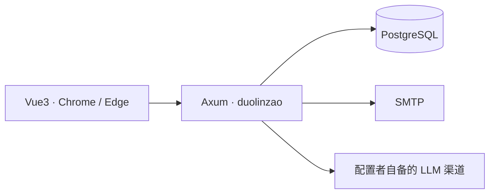
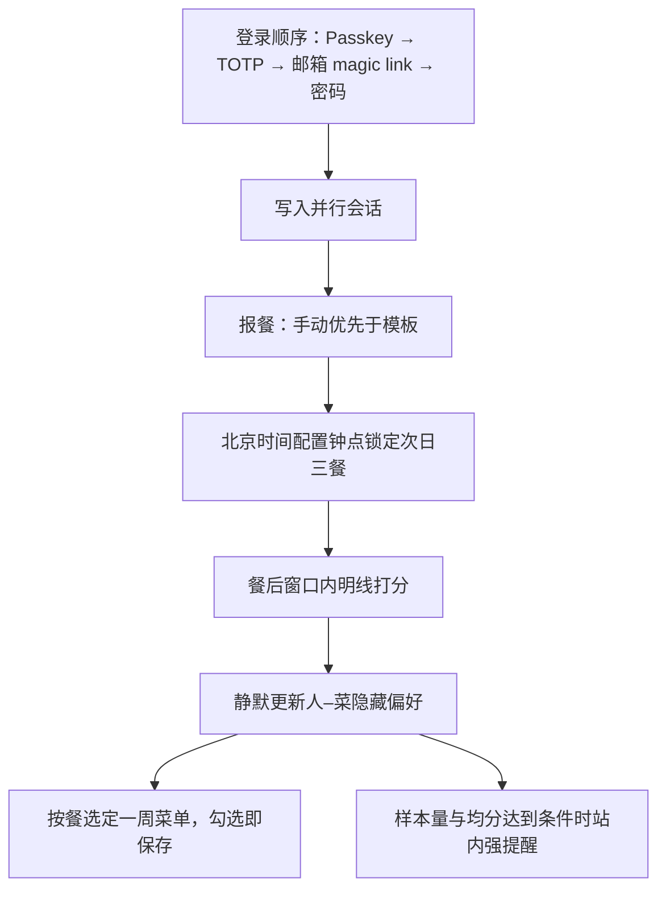
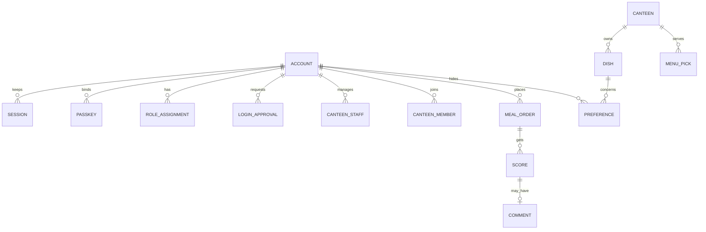

# 技术方案

## 1. 目标与约束

一期实现 [requirements.md](requirements.md) 的全部验收标准。产品边界以 [一期需求原文](../../docs/requirements-phase1.md) 为准。

已锁定的技术约束：

- 前端 Vue3，后端 Rust Axum，Rust crate 名为 `duolinzao`
- 浏览器目标为 Chrome / Edge（含 Windows）
- 交付物是 Docker 镜像；部署与备案由使用方自理
- 无支付、无短信 OTP、无夜宵、无微信小程序、无完整 PWA Web Push

下文的库表、接口和配置项是实现方案。其中截止钟点、餐后起算时刻、样本量下限不设产品默认值，由总管理配置文件给出。

## 2. 架构

单实例服务。浏览器访问 Vue3 单页应用，页面调用同一来源下的 Axum JSON API。业务数据、会话和审计放在 PostgreSQL。邮件 magic link 通过部署方配置的 SMTP 发出。模板生成器按配置顺序调用外部 LLM；「上二休四」也可由本地脚本生成，仍走同一个生成接口。



业务时区固定为北京时间（`Asia/Shanghai`）。截止、评分窗口和班制循环都按该时区计算。



## 3. 技术选型

| 层 | 选型 | 理由 |
|----|------|------|
| 前端 | Vue 3、TypeScript、Vite、Vue Router、Pinia | 锁定 Vue3；路由与登录态需要明确的客户端结构 |
| 后端 | Rust、Axum、Tokio、Tower | 锁定 Axum |
| 数据库 | PostgreSQL、SQLx | 一期业务库用 PostgreSQL；迁移和查询用 SQLx |
| 密码 | Argon2id | 兜底密码用 Argon2id 哈希 |
| Passkey | WebAuthn | 对应 Passkey / WebAuthn |
| TOTP | 标准 TOTP | 对应第二优先级登录 |
| 会话 | 服务端会话表 + HttpOnly Cookie | 并行会话与踢设备需要服务端逐条失效 |
| 邮件 | SMTP | 只服务邮箱 magic link |
| 迁移 | SQLx migration | 与查询库一致 |

一期技术底座是 PostgreSQL、SQLx 和 Argon2id。不引入 Redis。会话、邀请码和 magic link 都放在 PostgreSQL。不引入短信网关。

仓库布局：

```text
src/            Axum 二进制 crate duolinzao
migrations/     SQLx 迁移
web/            Vue3 前端
config.example.toml
```

界面文案使用简体中文。

## 4. 权限

一期授权是 Scoped RBAC。权限码是固定集合，角色是这些码的集合。判定只看「账号是否持有该角色分配」以及「分配上的食堂范围是否覆盖目标」。截止时间、评分窗口、不自动下架不参与这层判断。

角色代码：`employee`、`canteen`、`admin`、`super_admin`。总管理与超管都是 `super_admin`。权限码与 `● / —` 矩阵以 [requirements.md](requirements.md) 需求 2 为准，不在这里另定一张。

分配规则：

- `employee` 分配没有食堂管理范围。员工绑定多个食堂写在使用关系里，鉴权时不当成 `canteen` 或 `admin` 的 `canteen_id` 列表。
- `canteen` 与 `admin` 分配必须带 `canteen_id` 列表。`menu.read`、`menu.write`、`optimizer.read`、`meal.admin_override`、`rating.admin_read`、`comment.admin_read` 只在列表内的食堂生效。
- `super_admin` 分配的范围是 `*`，并带有 `system.super`。
- 标签只用来生成或对应一条 `admin` 分配（角色 + 食堂范围）。授权代码不解释标签字符串。
- 同一账号可以有多条分配。一次操作选用实际命中的那条角色，并把该角色和范围写入审计。
- `device.approve` 只允许处理本账号的待确认登录，不因 `super_admin` 或食堂范围去批准别人的新设备。
- `user.invite` 不按食堂拆开。`user.recover`、`audit.read`、`export.run`、`rating.strong_alert_config` 只属于 `super_admin`。
- `canteen` 在自己的 `canteen_id` 列表内同时拥有 `comment.admin_read` 与 `rating.admin_read`。员工端仍然不展示菜品排行。

## 5. 配置文件

`config.toml` 由部署方挂载，不把密钥写入仓库。

初始化与运行至少包括：

- 总管理用户名，以及初始密码或首次必须替换的随机口令
- WebAuthn 的 relying party 标识与来源
- 邮箱能力开关。关闭时不提供 magic link，也不强制邮箱验证；此时 SMTP 可以不填
- SMTP，仅在邮箱能力开启时必填
- 北京时间截止钟点 `lock_time`
- 早、中、晚三个餐后起算时刻
- 强提醒均分阈值，初始值；运行中可由总管理修改
- 强提醒样本量下限，初始值；运行中可由总管理修改
- 用于加密 LLM key、TOTP 密钥和 magic link 材料的本地密钥
- 餐品图片目录 `dish_image_dir`，以及单张图片大小上限 `dish_image_max_bytes`。仓库不写死字节数

`lock_time`、餐后时刻、样本量下限、图片目录和大小上限缺任一值时，进程拒绝启动并指出缺项。均分阈值同样必填。

## 6. 数据模型



主要字段：

- `account`：唯一字符串用户名、可选邮箱、可空密码哈希。邮箱只在使用 magic link 前绑定，注册时不强制。
- `invite_code`：持有 `user.invite` 的账号发放，一次性。
- `role_assignment`：`account_id`、`role`、`canteen_ids`（`super_admin` 为空并视为 `*`）、可选的来源标签文本。授权不读取标签文本。
- `canteen`、`canteen_member`、`canteen_staff`：员工绑定与食堂管理人员分开。`canteen_staff` 与 `canteen` 角色分配指向同一批食堂。
- `passkey`、`totp_credential`、`session`、`device`：Passkey 与会话分离。踢设备只失效会话；解绑 Passkey 只作废对应凭证。
- `login_approval`：新设备待确认请求。字段包括状态（待确认 / 已允许 / 已拒绝）、User-Agent、能解析出的设备或浏览器名称、IP、创建时间。允许或拒绝后状态不再回到待确认。
- `shift_plan`：`work2_rest4` 或 `custom`。上二休四保存锚点日。
- `meal_template`：每个用户一份个人 DSL。脚本、LLM 和轻度改餐都写回这一份，内容为各餐是否报餐及食堂。
- `meal_order`：唯一键 `(account_id, meal_date, slot)`。`slot` 仅为 `breakfast | lunch | dinner`。记录 `canteen_id`、来源 `dsl`、`submitted_at`、`locked_at`。
- `dish`：属于一个食堂。`kind` 必填，只能是 `菜`、`饭` 或 `汤`。菜是热菜、凉菜等菜肴，饭是米饭、面食等主食，汤是汤。没有第四类。缺少类别或写入这三类以外的值时拒绝。另有启用 / 停用状态。停用只来自食堂人员或管理员的显式操作。`image_path` 可空，是 `dish_image_dir` 下的对象相对路径；库里不存图片字节。接口在有路径时返回 `image_url`，否则为 null。`taste_tags` 是可空的短标签列表，由 `menu.write` 维护，例如酸、甜、开胃。
- `menu_pick`：某食堂、某日、某餐已选定的餐品。唯一键 `(canteen_id, meal_date, slot, dish_id)`。`slot` 仅为 `breakfast | lunch | dinner`。每条带上所属 `dish` 的 `kind`。勾选写入，取消删除。只能引用该食堂当前启用的餐品。
- `score`：唯一键 `(account_id, meal_date, slot, dish_id)`，分数为 `smallint`，只允许 −2 到 2 的整数。
- `comment`：可选，挂在 `score` 上，最长 300 字，含匿名标记与 `deleted_at`。没有对应分数就不能插入评语。
- `preference`：`(account_id, dish_id)` 的隐藏数值，只供服务端计算。
- `notification`：站内提示。
- `llm_channel`：全站一份列表，由持有 `system.super` 的总管理维护。字段为顺序、渠道种类、base URL、模型名和加密后的 key。不属于员工账号。
- `audit_log`：时间、操作者、当时使用的角色、食堂范围或 `*`、动作、对象、不含密钥的摘要。
- `app_setting`：可在运行中修改的均分阈值和样本量下限。截止钟点仍以配置文件为准。

隐藏偏好采用该用户对该餐品历次明线分数的算术平均，并保存样本数。这个数值只存在于 `preference` 和选菜计算中。选菜排序在菜、饭、汤每一类内部，把该日该餐预计在该食堂就餐的人对同一道候选的偏好取平均，平均更高的排在该类前面；该类中无人评分的排在有评分的之后。上色严格表示这个偏好：更高更绿，更低更红；无人评分用中性色，不染成绿或红。色块不标注数字，也不使用与偏好无关的装饰色。口味标签随卡片返回，不参与排序和上色。三类各自成组返回，不排进同一条混合列表。

强提醒同时读取可见评分与隐藏偏好所依据的同一批分数：可见均分低于阈值，且该菜评分人数达到样本量下限时，给该食堂管理人员写一条站内提示，请其考虑停用。程序不修改 `dish` 的启用状态。界面只写「样本已足够，均分低于当前阈值」，不写倾向、权重或 Elo。

### 6.1 一周排菜

选菜优化有两个状态，仍是同一幅画面。

**周视图**是进入时的默认状态。一周按北京时间周一至周日计，共 7 天，每天 `breakfast | lunch | dinner`。每一格读取该食堂该日该餐的 `menu_pick`，并按 `kind` 分成菜、饭、汤三列；某一类没有记录就显示为空，不把三类拼成一条名单。可以切到上一周或下一周。响应不含偏好数值。

**当餐选定**从周视图的一格进入。可选池是该食堂当前启用的餐品，按 `kind` 分成三组。组内排序和上色与上文相同。勾选写入 `menu_pick`，取消删除。每次变更立即保存。防抖间隔是实现参数，不能变成必须再点一次保存才落库。离开页面或返回周视图后，已经写入的结果仍在，周视图读到的就是这份结果。

「保存并前进」不额外承担落库，只跳到下一餐的选定页：早餐到同一天午餐，午餐到同一天晚餐，晚餐到下一天早餐。周日晚餐跳到下一周周一早餐，周视图的周一起始日随之改为那一周。员工的 `meal_order` 不因排菜而改写。这里的「把一周定下来」指这一周里已经选定的餐次都写入了 `menu_pick`，某一餐或某一类可以仍为空。不读取 `lock_time`，也不增加冻结字段。写入使用已有的 `optimizer.read` 和食堂范围，不新增权限码。选定结果的变更计入菜谱变更审计，带上操作者、角色和范围。

### 6.2 餐品图片

每道餐品最多一张图。新建和编辑用 `menu.write` 上传；编辑还可以更换或移除。不上传也能保存。文件内容必须是 JPEG、PNG 或 WebP，且不超过 `dish_image_max_bytes`。扩展名与内容不符时拒绝。新文件替换旧文件，移除时删掉目录中的文件并清空 `image_path`。

列表、周视图、当餐选定、员工可评列表和评分汇总只返回图片地址或空，不把字节嵌进 JSON。地址指向 `GET /api/dishes/{id}/image`。该接口要求登录，并且调用者要满足下面之一：覆盖该食堂的 `menu.read`、`optimizer.read` 或 `rating.admin_read`；或者持有 `rating.self_write`，且这道餐品属于本人已报、并在评分窗口内的那一餐。其余请求拒绝。

选菜优化和评分在餐品旁显示这张图。菜谱列表可以显示缩略图，不强制。`image_url` 为空时画面用中性占位，不用另一道菜的图充数。审计摘要只记图片已上传、已更换或已移除，不写入字节。导出菜谱时带上对应图片文件。

## 7. 关键规则

### 7.1 登录与新设备

登录页按 Passkey、TOTP、邮箱 magic link、密码排列，密码入口放在最后。邮箱能力由总管理开关控制，关闭后页面不出现 magic link，注册和登录都不要求验证邮箱，进程不因缺少 SMTP 而拒绝启动。开启时 magic link 仍在 TOTP 和密码之间，并可直接建立会话。

新设备若要由旧设备授权，则创建 `login_approval`，不走扫码。一期不实现扫码授权。已登录设备打开网页时拉取尚未决定的请求；页面保持打开时继续轮询。轮询间隔是实现参数。确认层是页面内的模态框，至少显示 User-Agent、IP，以及解析得到的设备或浏览器名称。不调用操作系统推送。

任一已登录设备允许后，新设备获得独立会话，旧会话保留，并可以接着绑定本机 Passkey。拒绝后该请求结束，新设备得不到会话。

Magic link 单次有效，15 分钟过期。这个时长是实现参数。待确认请求保持到被允许或拒绝，一期不因为超时把它清掉。

### 7.2 班制与自动报餐

上二休四从锚点日起算，周期为工作、工作、休息、休息、休息、休息。用户选定该班制后，本地脚本写入其个人 DSL 的工作日。自定义排班把班制描述交给统一生成接口，产物同样是这份 DSL。

用户对某一餐的轻度修改，以及预览里绿色报餐 / 橙色不报的切换，都写回个人 DSL。自动任务只处理已经选定班制或已经有过报餐记录的账号，并按 DSL 生成尚未锁定的餐次。后一次生成覆盖尚未锁定的同餐记录。已锁定的餐次跳过。休息日不生成自动报餐。用户仍可把休息日改成报餐，该修改写回 DSL，但在锁定前才会生成报餐记录。

一键套用按同一份 DSL 写入指定日期范围。

### 7.3 覆盖与锁定

同一餐次的写入：

1. 轻度修改先写回个人 DSL，再生成该餐尚未锁定的记录，来源记为 `dsl`。
2. 再次按 DSL 生成时，覆盖尚未锁定的同餐记录。
3. `locked_at` 已设置时，生成任务不改这条记录。没有 `meal.admin_override` 或食堂范围不覆盖的写入全部拒绝；命中的 `admin` 或 `super_admin` 可以修改，并记审计。

每日到配置的 `lock_time`，锁定次日三个餐次的全部已有报餐，并拒绝此后没有 `meal.admin_override` 的写入。三个餐次同一时刻锁定。

### 7.4 评分窗口

评分对象必须是本人该日期该餐次已经报过的餐，且餐品属于该食堂在该日期该餐次已写入 `menu_pick` 的选定结果。窗口从配置的餐后时刻开始，到之后满 7 日结束。窗口外拒绝。不提供修改他人分数的路径。同一「餐次 + 菜」再次提交时拒绝，一期不提供改分接口。

评语软删除只保留数据库字段。路由表中不注册删除评语的接口，管理端也不提供删除操作。

## 8. 接口

全部业务接口在 `/api` 下，请求和响应使用 JSON。未登录返回 401，无身份返回 403。业务拒绝使用 4xx 和稳定错误码。任何响应体都不包含隐藏偏好数值、密码哈希、TOTP 密钥、LLM key 或 magic link 原文。

| 分组 | 方法与路径 | 说明 |
|------|------------|------|
| 注册 | `POST /api/register` | 字符串账号 + 邀请码 |
| 登录 | `POST /api/session/passkey/start`、`finish` | WebAuthn |
| 登录 | `POST /api/session/totp` | TOTP |
| 登录 | `POST /api/session/magic-link/request`、`consume` | 邮箱链接 |
| 登录 | `POST /api/session/password` | 兜底密码 |
| 设备 | `POST /api/login-approvals` | 新设备创建待确认请求 |
| 设备 | `GET /api/login-approvals/pending` | 已登录设备读取本账号待确认请求 |
| 设备 | `POST /api/login-approvals/{id}/allow`、`deny` | 页内允许或拒绝；允许后可绑定 Passkey |
| 设备 | `GET /api/devices`、`DELETE /api/devices/{id}` | 查看与踢设备 |
| 设备 | `DELETE /api/passkeys/{id}` | 解绑 Passkey |
| 食堂 | `PUT /api/me/canteens` | 员工绑定多个食堂 |
| 报餐 | `PUT /api/me/shift` | 两种班制之一 |
| 报餐 | `POST /api/meal-templates/generate` | 唯一模板生成接口 |
| 报餐 | `PUT /api/meal-templates/{id}` | 手改预设 |
| 报餐 | `POST /api/meal-templates/{id}/apply` | 一键套用到多天 |
| 报餐 | `PUT /api/meals/{date}/{slot}` | 手动报餐，含所选食堂 |
| 管理 | `PUT /api/admin/meals/{account_id}/{date}/{slot}` | 截止后改单 |
| 管理 | `POST /api/admin/invites` | 发放邀请码 |
| 管理 | `GET /api/admin/comments` | 查看评语；按菜、饭、汤分组或筛选；匿名不返回账号 |
| 管理 | `GET /api/admin/score-summaries` | 评分汇总；按菜、饭、汤分组或筛选；带图片地址或空；不含暗线数值 |
| 总管理 | `POST /api/admin/recovery` | 密码或账号找回 |
| 总管理 | `PUT /api/admin/settings/score-alert` | 修改均分阈值与样本量下限 |
| 总管理 | `GET /api/admin/llm-channels`、`PUT /api/admin/llm-channels` | 维护全站渠道顺序、种类、base URL 和模型名。要 `system.super`。响应只表明 key 是否已配置，不回显原文 |
| 总管理 | `POST /api/admin/exports` | 数据导出 |
| 菜谱 | `/api/canteens/{id}/dishes` | 维护菜谱。创建和修改必须带 `kind`，且只能是菜、饭、汤。可附带 `taste_tags` 和一张 JPEG、PNG 或 WebP。列表按这三类分组或筛选，并带 `image_url` 或 null |
| 菜谱 | `GET /api/dishes/{id}/image` | 读取图片字节。登录且具备上文的查看条件；否则拒绝 |
| 菜谱 | `DELETE /api/canteens/{id}/dishes/{dish_id}/image` | 移除图片。要 `menu.write` 且范围覆盖 |
| 选菜 | `GET /api/canteens/{id}/selection/week?date=` | 周视图。把 `date` 归到北京时间所在周的周一，返回 7 天 × 三餐；每餐的已选按菜、饭、汤分组，并带口味标签和 `image_url` 或 null。色阶为更高更绿、更低更红。不含偏好数字 |
| 选菜 | `GET /api/canteens/{id}/selection?date=&slot=` | 当餐选定。启用餐品按菜、饭、汤分组，返回组内排序、绿到红色阶、是否已选、口味标签和 `image_url` 或 null，不含偏好数字 |
| 选菜 | `PUT /api/canteens/{id}/selection/{date}/{slot}` | 立即保存该餐已选餐品。勾选或取消都会调用。跳到下一餐由客户端完成 |
| 评分 | `GET /api/me/score-targets` | 当餐可评内容，按菜、饭、汤分组，并带图片地址或空 |
| 评分 | `POST /api/scores` | 分数必填，评语可选 |
| 通知 | `GET /api/notifications` | 站内提示 |
| 预留 | `POST /api/push/reservations` | 一期固定返回 `501 push_not_in_phase1`，不投递 |

`POST /api/meal-templates/generate` 的提供者序列为：全站渠道列表中的本地脚本（若启用）与 LLM 渠道，严格按总管理保存的顺序尝试。OpenAI 旧接口对应 Chat Completions，OpenAI 新接口对应 Responses API，Anthropic 对应 Messages API。DeepSeek、通义和其它 OpenAI 兼容服务使用旧接口形态，由总管理在「LLM 渠道配置」填写 base URL 和模型名。员工不调用渠道维护接口。

## 9. 安全

- Cookie 使用 `HttpOnly`、`Secure`、`SameSite=Lax`。
- 邀请码和 magic link 只存哈希，单次使用。
- 每个会改数据的接口先查权限码和食堂范围，再执行领域规则。
- 审计摘要禁止写入密码、TOTP 密钥、会话令牌、magic link、邀请码原文、LLM key 和餐品图片字节。
- LLM key 使用配置文件中的本地密钥加密后落库，接口只返回渠道是否已配置。
- 导出文件包含食堂、菜谱、餐品图片、报餐、评分、评语和审计，排除上述密钥材料与密码哈希。
- 账号找回由总管理执行：重置密码或清除失效的登录材料，使账号可以重新绑定 Passkey。不提供短信找回。
- 登录失败需要限速。限速阈值是实现参数，不改变登录优先级。

## 10. 测试策略

- Rust 集成测试覆盖：邀请码注册、四种登录的优先级约束、并行会话不被自动踢掉、待确认请求在页面打开后仍可允许或拒绝、允许后发会话且可绑 Passkey、拒绝后无会话、确认层含 UA 与 IP、轻度改餐写回个人 DSL、DSL 生成覆盖未锁定同餐且跳过已锁定餐、截止后无 `meal.admin_override` 被拒绝、食堂范围外的改单和菜谱写入被拒绝、评分窗口、只写评语被拒绝、重复评分被拒绝、匿名评语响应不含账号、强提醒不改菜品状态、渠道顺序、推送预留返回 501。
- 菜谱写入缺少 `kind`，或 `kind` 不是菜、饭、汤时拒绝。菜谱列表、选菜、评分目标、评分汇总、评语和强提醒的响应按这三类分组或可按类筛选，不返回跨类混合的单列表。
- 餐品图片可以不传。非法类型或超过大小上限时拒绝。有图片时，菜谱列表、周视图、当餐选定、员工评分和评分汇总带上图片地址；没有权限的取图请求被拒绝。审计摘要不含图片字节。
- 选菜的勾选和取消在离开画面后仍然保留。周视图返回周一至周日，且每餐按菜、饭、汤分组。保存并前进的顺序为早餐、午餐、晚餐、下一天早餐；周日晚餐的下一餐是下周一早餐。范围外的写入被拒绝。
- 对评分、选菜和强提醒的响应做快照或字段断言，确认没有偏好数值、倾向、权重、Elo。
- 审计测试写入一条未满 6 个月的日志并确认仍可查询、不可被保留策略删除；日志含操作者、角色和范围。
- Vue 组件测试确认登录入口顺序、员工页没有菜品排行、员工评分页把菜、饭、汤分成三组并显示餐品图片、食堂选菜先进入周视图且每格分列菜 / 饭 / 汤和图片、当餐选定在每一组内有顺序、颜色和图片且没有内部术语、新建菜和编辑菜可以上传图片、勾选后无需再点保存即能跳到下一餐、菜谱与评语画面不把三类混成一张列表、已打开页面出现允许 / 拒绝确认层、班制页没有上五休二。
- 一期手工验收使用 Chrome 与 Edge。自动化测试不把 Firefox 或 Safari 列为通过条件。

## 11. 交付

镜像内包含 Axum 二进制和 Vue3 构建产物。PostgreSQL 由部署方一并运行，不把数据库塞进业务镜像。餐品图片放在挂载的 `dish_image_dir`，不打进镜像。示例编排只引用挂载的 `config.toml`，示例中的钟点、阈值、图片大小上限和密钥使用空值或明显的占位符。

仓库许可证为 AGPL-3.0。镜像与源码分发时保留该许可证。

## 12. 一期不做

支付、短信 OTP、夜宵、上五休二、多班叠加、按食堂发布不同班制、员工端菜品排行、自动下架、评语删除接口、PWA Web Push 的实际投递、新设备确认所需的系统推送、扫码授权、以 ACL / ABAC / ReBAC 作为主授权模型、微信小程序，以及按员工竖屏参考图去画食堂端。食堂端以 `docs/ui/` 里标为主参考的横屏稿和需求第 11 节为准，不采用旧稿的另一套导航。
